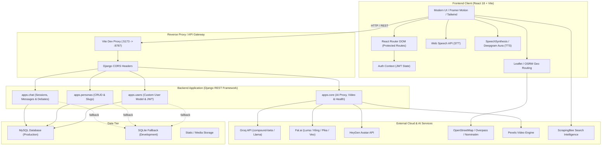
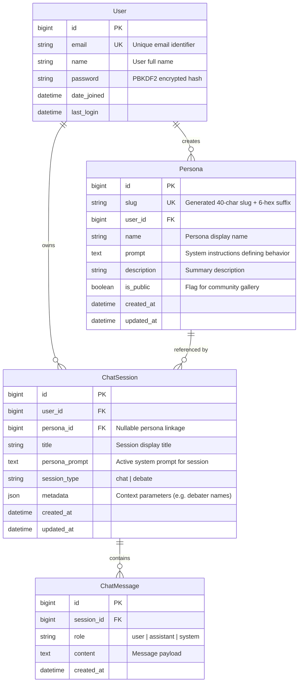

<div align="center">

# 🎭 PersonaAI

### *The Autonomous AI Persona & Multi-Agent Experiential Platform*

[](https://www.djangoproject.com/)
[](https://react.dev/)
[](https://vitejs.dev/)
[](https://tailwindcss.com/)
[](https://groq.com/)
[](https://opensource.org/licenses/MIT)
[](CONTRIBUTING.md)

<p align="center">
  <b>PersonaAI</b> is a full-stack, enterprise-grade AI persona ecosystem. Design hyper-personalized AI identities, hold duplex voice conversations, orchestrate autonomous multi-persona debates, generate multimodal videos, plan intelligent geographic itineraries, and deploy bespoke AI personas across the web.
</p>

[Explore Features](#-key-features) •
[System Architecture](#-system-architecture) •
[Quickstart Guide](#-quickstart-guide) •
[API Documentation](#-api-reference) •
[Environment Configuration](#-environment-variables)

</div>

---

## 📑 Table of Contents

- [🌟 Platform Overview](#-platform-overview)
- [✨ Key Features](#-key-features)
  - [🧠 Dynamic Persona Studio & Engine](#1--dynamic-persona-studio--engine)
  - [💬 Contextual Multi-Session Chat](#2--contextual-multi-session-chat)
  - [🎙️ Full-Duplex Voice & Audio Suite](#3--full-duplex-voice--audio-suite)
  - [🗣️ Autonomous AI Debate Arena](#4--autonomous-ai-debate-arena)
  - [📞 Live Real-Time Voice Calls](#5--live-real-time-voice-calls)
  - [✍️ Persona-Driven AI Smart Writer](#6--persona-driven-ai-smart-writer)
  - [🗺️ AI Trip Planner & Geo-Routing](#7--ai-trip-planner--geo-routing)
  - [🎬 Creative Multimodal Video Studio](#8--creative-multimodal-video-studio)
  - [🎮 Game Zone & Unbeatable Minimax AI](#9--game-zone--unbeatable-minimax-ai)
  - [⚖️ AI Decision & Rationality Helper](#10--ai-decision--rationality-helper)
- [🏗️ System Architecture](#-system-architecture)
- [🗄️ Database Schema & Data Models](#-database-schema--data-models)
- [🚀 Quickstart Guide](#-quickstart-guide)
  - [Prerequisites](#prerequisites)
  - [1. Clone Repository](#1-clone-repository)
  - [2. Backend Setup](#2-backend-setup)
  - [3. Frontend Setup](#3-frontend-setup)
  - [4. Running the Application](#4-running-the-application)
- [⚙️ Environment Variables](#-environment-variables)
- [📡 API Reference](#-api-reference)
  - [Authentication](#authentication)
  - [Personas](#personas)
  - [Chat & Debate Sessions](#chat--debate-sessions)
  - [AI Inference & Video Generation](#ai-inference--video-generation)
- [📂 Project Structure](#-project-structure)
- [🛡️ Security & Resilience](#-security--resilience)
- [🤝 Contributing](#-contributing)
- [📄 License](#-license)

---

## 🌟 Platform Overview

Traditional chatbot interfaces restrict conversational agents to static prompts and generic assistant identities. **PersonaAI** transforms conversational AI by treating persona identities as first-class, stateful software entities:

- **Identity Synthesizer**: Create personas via guided structured inputs (tone, traits, knowledge domain, catchphrases), raw prompt customization, or web-mined profiles extracted via real-time search intelligence.
- **Autonomous Multi-Agent Debate**: Watch two AI personas with diametrically opposed personas debate complex philosophical or technical topics in real-time with zero human intervention.
- **Hands-Free Duplex Voice**: Real-time speech-to-text (Web Speech API) coupled with natural speech synthesis (browser TTS & Deepgram Aura) creates a natural telephone call experience.
- **Travel & Geo-Intelligence**: Integrates Leaflet, OSRM routing, OpenStreetMap Nominatim, Overpass POIs, and Wikipedia landmarks with AI-generated multi-day itineraries and multimodal cab/transit fare estimation.
- **Hybrid Multimodal Media Engine**: Generate AI video scripts and full videos powered by Fal.ai (Luma Dream Machine, Kling, Pika), HeyGen digital avatars, or automated contextual B-roll matching.

---

## ✨ Key Features

### 1. 🧠 Dynamic Persona Studio & Engine
- **Structured Persona Architect**: Form-based identity configuration across 8 core behavioral parameters (Identity, Bio, Tone of Voice, Response Style, Common Phrases, Core Expertise, and Boundaries).
- **Live Prompt Preview**: Real-time compilation of form inputs into an optimized system prompt that instructs the LLM on conversational boundaries.
- **Social & Search Mining**: Synthesize realistic personas directly from public search records (via ScrapingBee / Google Search) extracting background, achievements, and unique speech traits.
- **Public Persona Sharing**: Every persona receives a collision-free unique URL (`/p/:slug`), permitting public sharing, showcase viewing, and social duplication.

### 2. 💬 Contextual Multi-Session Chat
- **Multi-Session Isolation**: Organize conversations by topics or personas; switch, create, and delete chat threads seamlessly.
- **Resilient AI Proxy**: Low-latency responses powered by Groq API (`compound-beta` / `llama-3.3-70b-versatile`) with automatic fallback routing.
- **Context Window Management**: Automatic history pruning and token safeguards ensure prompt stability without memory degradation.
- **Full Markdown & Action Bar**: Syntax-highlighted code blocks, copy-to-clipboard, audio playback, and session deletion.

### 3. 🎙️ Full-Duplex Voice & Audio Suite
- **Hands-Free Speech-to-Text (STT)**: Built on the Web Speech Recognition API with real-time interim speech preview, automatic silence detection, and retry resilience.
- **Multi-Voice Text-to-Speech (TTS)**: Dynamic voice playback supporting custom accents, speeds, and pitches, backed by browser `speechSynthesis` and optional Deepgram Aura models.
- **Voice Control HUD**: Dedicated modal to tune speech rate, pitch, preferred voice personas, and microphone thresholds.

### 4. 🗣️ Autonomous AI Debate Arena
- **Zero-Human Dual-AI Arguments**: Select two conflicting personas (e.g., *Pirate Captain* vs *Strict Victorian Teacher* or *Socrates* vs *Nietzsche*), assign a topic, and watch them autonomously debate round-by-round.
- **Typewriter Text & Audio Equalizers**: Words stream across the UI with dynamic typewriter cadence accompanied by animated visual audio frequency bars.
- **Alternating Voice Synthesis**: Debaters speak in distinctly tuned voices with pitch and rate offsets to reflect their respective personalities.
- **Full Debate Persistence**: Debates are saved to the Django backend under `session_type="debate"` with full replay and transcript management.

### 5. 📞 Live Real-Time Voice Calls
- **Simulated Voice Calling UI**: Hands-free calling interface with pulsing radial wave rings, active speaker states, call duration timers, and call status indicators (`idle` → `calling` → `connected` → `ended`).
- **Real-Time Voice Activity Detection**: Automatically listens when the user finishes speaking, triggers AI persona generation, and responds with audio output without requiring button clicks.
- **Slide-Out Transcript Drawer**: Full transcript history available on demand during or after the live phone call.

### 6. ✍️ Persona-Driven AI Smart Writer
- **Multi-Channel Content Generation**: Draft high-impact content in the voice of any persona across 8 formats:
  - 📧 Email (Formal/Casual with salutation & sign-off)
  - 🐦 Tweet / X Post (Punchy, under 280 characters with hashtags)
  - 📝 Blog Introduction (Engaging hooks and thesis statements)
  - 💼 LinkedIn Post (Thought leadership formatting with hooks)
  - 📖 Essay Paragraph (Academic structure with topic sentences)
  - 💻 Code Comments & Documentation (Technical persona tone)
  - 📸 Social Media Captions & Summaries
- **Tone Modulation**: Adapt output tone between *Professional, Casual, Funny, Academic, Poetic,* and *Persuasive*.
- **Metrics & Clipboard**: Real-time word counter, character counter, and 1-click copy action.

### 7. 🗺️ AI Trip Planner & Geo-Routing
- **Interactive Routing Engine**: Built with Leaflet, React-Leaflet, and OSRM routing. Renders turn-by-turn road routes, multi-stop waypoints, and calculates exact road distances and driving durations.
- **Landmark Discovery & Imagery**: AI brainstorms authentic tourist spots for any destination; coordinates are geocoded via OpenStreetMap Nominatim and matched with Wikipedia imagery.
- **Overpass POI Explorer**: Discovers nearby hotels, restaurants, and attractions along route segments.
- **Multimodal Transit Cost Estimator**: Heuristic cost and travel time calculators for 6 transit options:
  - 🏍️ Bike (< 30 km)
  - 🛺 Auto-Rickshaw (< 40 km)
  - 🚗 Cab / Taxi (Any distance)
  - 🚌 Intercity Bus / Volvo Sleeper (< 1,200 km)
  - 🚆 Express Train (AC 2A/3A tiers)
  - ✈️ Flight (> 400 km with check-in buffer)
- **Day-by-Day Scheduling**: Generates granular morning, afternoon, and evening itineraries tailored to trip duration.

### 8. 🎬 Creative Multimodal Video Studio
- **Generative AI Video Pipelines**: Submit creative prompts to generate cinematic videos via Fal.ai API:
  - Luma Dream Machine (`fal-ai/luma-dream-machine`)
  - Kling Video (`fal-ai/kling-video/v1.6/standard/text-to-video`)
  - Pika (`fal-ai/pika`)
  - Google Veo
- **Digital Avatar Avatars (HeyGen)**: Generate talking-head avatar videos from scripted persona prompts with video generation status polling.
- **Automated B-Roll Fallback**: Contextual keyword matching maps prompt semantics to curated Pexels HD video clips (ocean, tech, cityscape, nature, space, animals) with zero downtime.
- **Ethereal Memorial Clips**: Generate walking/ethereal memorial video scenes from user photo uploads.

### 9. 🎮 Game Zone & Unbeatable Minimax AI
- **Minimax Tic-Tac-Toe**: Interactive game against an AI opponent powered by an optimal minimax adversarial search algorithm with depth-weighted heuristics.
- **Celebration Effects**: Realistic confetti cannon physics (`canvas-confetti`) trigger upon victories or milestones.
- **Sound & Haptics**: Audio and visual feedback for moves, wins, and draws.

### 10. ⚖️ AI Decision & Rationality Helper
- **Logical Deconstruction**: Breaks down complex dilemmas into trade-offs, probabilities, and actionable next steps.
- **Speech Recognition Integration**: Discuss dilemmas hands-free with speech-to-text input and instant speech-synthesized playback.
- **Latency Monitoring**: Built-in round-trip latency counter to monitor inference responsiveness.

---

## 🏗️ System Architecture



---

## 🗄️ Database Schema & Data Models



> [!NOTE]
> Database indexes are configured on `ChatSession(user, session_type, -updated_at)` and `ChatMessage(session, created_at)` to guarantee constant-time lookup performance during chat hydration.

---

## 🚀 Quickstart Guide

### Prerequisites
- **Node.js**: v18.0.0 or higher
- **npm**: v9.0.0 or higher
- **Python**: v3.10, v3.11, or v3.12
- **MySQL**: (Optional) v8.0+. If unconfigured, the application automatically uses an embedded SQLite database.

---

### 1. Clone Repository

```bash
git clone https://github.com/your-username/PersonaAI.git
cd PersonaAI
```

---

### 2. Backend Setup

```bash
cd backend

# Create and activate virtual environment
python3 -m venv venv
source venv/bin/activate       # On Windows: venv\Scripts\activate

# Install dependencies
pip install -r requirements.txt

# Configure environment variables
cp .env.example .env          # Or create .env as outlined below

# Run database migrations
python3 manage.py migrate

# (Optional) Create superuser for Django admin
python3 manage.py createsuperuser
```

---

### 3. Frontend Setup

```bash
cd ../frontend

# Install node dependencies
npm install

# (Optional) Create frontend environment file
cp .env.example .env
```

---

### 4. Running the Application

You can start both frontend and backend concurrently with one command from the `frontend` folder:

```bash
cd frontend
npm run dev:all
```

Alternatively, run each service in separate terminal windows:

#### Terminal 1 — Backend:
```bash
cd backend
source venv/bin/activate
python3 manage.py runserver 8787
```

#### Terminal 2 — Frontend:
```bash
cd frontend
npm run dev
```

Visit **http://localhost:5173** in your browser.

| Service | Local URL | Notes |
| :--- | :--- | :--- |
| **Frontend Web App** | `http://localhost:5173` | Hot-reloading Vite dev server |
| **Backend API** | `http://localhost:8787/api/` | Django REST Framework API root |
| **Django Admin** | `http://localhost:8787/admin/` | Database management portal |
| **API Health Check** | `http://localhost:8787/api/health` | Service & provider status check |

---

## ⚙️ Environment Variables

### Backend Configuration (`backend/.env`)

```ini
# ==========================================
# Core Django Settings
# ==========================================
SECRET_KEY=django-insecure-your-super-secret-key-here
DEBUG=True
ALLOWED_HOSTS=localhost,127.0.0.1

# ==========================================
# Database (MySQL)
# Omit DB_NAME / DB_USER to fallback to SQLite
# ==========================================
DB_NAME=persona_ai
DB_USER=root
DB_PASSWORD=your_mysql_password
DB_HOST=localhost
DB_PORT=3306

# ==========================================
# AI Model Inference (Groq)
# ==========================================
GROQ_API_KEY=gsk_your_groq_api_key_here
GROQ_MODEL=compound-beta
GROQ_FALLBACK_MODEL=llama-3.3-70b-versatile

# ==========================================
# Generative Video & Avatars (Fal.ai & HeyGen)
# ==========================================
FAL_KEY=your_fal_ai_key_here
HEYGEN_API_KEY=your_heygen_api_key_here
HEYGEN_API_BASE=https://api.heygen.ai
DEFAULT_HEYGEN_AVATAR_ID=your_avatar_id
DEFAULT_HEYGEN_VOICE_ID=your_voice_id

# ==========================================
# Media & Content Providers
# ==========================================
PEXELS_API_KEY=your_pexels_api_key_here
HF_API_TOKEN=your_huggingface_token_here
REPLICATE_API_TOKEN=your_replicate_token_here
DEEPGRAM_API_KEY=your_deepgram_api_key_here
```

### Frontend Configuration (`frontend/.env`)

```ini
# Base backend URL (leave empty if using Vite proxy)
VITE_API_BASE_URL=

# Deepgram Voice API Key (optional for high-definition Aura voices)
VITE_DEEPGRAM_API_KEY=your_deepgram_key

# Web search persona mining (optional)
VITE_SCRAPING_BEE_API_KEY=your_scrapingbee_key

# Apify platform integration (optional)
VITE_APIFY_API_TOKEN=your_apify_token
```

---

## 📡 API Reference

### Authentication

#### Register New User
```http
POST /api/auth/signup
Content-Type: application/json

{
  "name": "Ada Lovelace",
  "email": "ada@example.com",
  "password": "SecurePassword123!"
}
```
*Response (`201 Created`):*
```json
{
  "user": {
    "id": "1",
    "name": "Ada Lovelace",
    "email": "ada@example.com"
  },
  "token": "eyJhbGciOiJIUzI1NiIsInR5cCI6IkpXVCJ9..."
}
```

#### User Login
```http
POST /api/auth/login
Content-Type: application/json

{
  "email": "ada@example.com",
  "password": "SecurePassword123!"
}
```
*Response (`200 OK`):*
```json
{
  "user": {
    "id": "1",
    "name": "Ada Lovelace",
    "email": "ada@example.com"
  },
  "token": "eyJhbGciOiJIUzI1NiIsInR5cCI6IkpXVCJ9..."
}
```

#### Get Current Profile
```http
GET /api/auth/me
Authorization: Bearer <JWT_ACCESS_TOKEN>
```

---

### Personas

#### List User Personas
```http
GET /api/personas/
Authorization: Bearer <JWT_ACCESS_TOKEN>
```

#### Create New Persona
```http
POST /api/personas/
Authorization: Bearer <JWT_ACCESS_TOKEN>
Content-Type: application/json

{
  "name": "Socrates",
  "prompt": "You are Socrates. Answer every question with probing, thought-provoking philosophical inquiries.",
  "description": "Ancient Athenian philosopher who asks relentless questions."
}
```

#### Get Public Persona by Slug
```http
GET /api/personas/{slug}
```
*Response (`200 OK`):*
```json
{
  "persona": {
    "id": "4",
    "slug": "socrates-a3b19f",
    "name": "Socrates",
    "prompt": "You are Socrates...",
    "description": "Ancient Athenian philosopher...",
    "created_at": "2026-10-20T16:00:00Z",
    "creator_name": "Ada Lovelace"
  }
}
```

#### Delete Persona
```http
DELETE /api/personas/{id}
Authorization: Bearer <JWT_ACCESS_TOKEN>
```

---

### Chat & Debate Sessions

#### List Chat/Debate Sessions
```http
GET /api/chat-sessions/?type=chat
Authorization: Bearer <JWT_ACCESS_TOKEN>
```
*(Use `?type=debate` to fetch saved autonomous debates)*

#### Create Chat or Debate Session
```http
POST /api/chat-sessions/
Authorization: Bearer <JWT_ACCESS_TOKEN>
Content-Type: application/json

{
  "title": "AI Alignment Debate",
  "personaPrompt": "You are a cautious AI safety researcher...",
  "personaId": 4,
  "type": "debate",
  "metadata": {
    "persona1": "AI Optimist",
    "persona2": "AI Doomer",
    "topic": "Superintelligence Timeline"
  }
}
```

#### Get Session with Full Message History
```http
GET /api/chat-sessions/{id}
Authorization: Bearer <JWT_ACCESS_TOKEN>
```

#### Append Message to Session
```http
POST /api/chat-sessions/{id}/messages
Authorization: Bearer <JWT_ACCESS_TOKEN>
Content-Type: application/json

{
  "role": "user",
  "content": "What is virtue?"
}
```

#### Delete Session & Messages
```http
DELETE /api/chat-sessions/{id}
Authorization: Bearer <JWT_ACCESS_TOKEN>
```

---

### AI Inference & Video Generation

#### Fast Groq AI Proxy
```http
POST /api2/ask
Content-Type: application/json

{
  "messages": [
    { "role": "system", "content": "You are a concise decision advisor." },
    { "role": "user", "content": "Should I switch from monolith to microservices?" }
  ]
}
```
*Response (`200 OK`):*
```json
{
  "answer": "Start with a modular monolith. Extract microservices only when domain boundaries and team sizes require independent scaling.",
  "model": "compound-beta"
}
```

#### Generate Video (Fal.ai / HeyGen / Web fallback)
```http
POST /api/generate-video
Content-Type: application/json

{
  "prompt": "Futuristic cyberpunk neon city with rain reflections",
  "provider": "luma",
  "aspectRatio": "16:9"
}
```

#### Video Generation Status
```http
GET /api/generate-video-status?jobId=<REQUEST_OR_VIDEO_ID>
```

#### Service Health & Provider Telemetry
```http
GET /api/health
```
*Response (`200 OK`):*
```json
{
  "ok": true,
  "pexels": true,
  "heygen": false,
  "hf": false,
  "replicate": false
}
```

---

## 📂 Project Structure

```
personaAI/
├── backend/
│   ├── apps/
│   │   ├── users/                 # Custom AbstractUser, Auth views, JWT tokens & serializers
│   │   │   ├── models.py          # User entity definition (email-based auth)
│   │   │   ├── serializers.py     # Signup, Login & User serializers
│   │   │   ├── views.py           # Signup, login, me endpoints
│   │   │   └── urls.py            # /api/auth/ routing
│   │   ├── personas/              # Persona model, slug generation, CRUD & public view
│   │   │   ├── models.py          # Persona entity with automatic slug generation
│   │   │   ├── serializers.py     # Validation and representation formatting
│   │   │   ├── views.py           # List, create, retrieve, delete handlers
│   │   │   └── urls.py            # /api/personas/ routing
│   │   ├── chat/                  # Chat & Debate sessions, message logging
│   │   │   ├── models.py          # ChatSession & ChatMessage models
│   │   │   ├── serializers.py     # Nested message and session serializers
│   │   │   ├── views.py           # Session lifecycle & message append APIs
│   │   │   └── urls.py            # /api/chat-sessions/ routing
│   │   └── core/                  # Core services, Groq proxy & video synthesis
│   │       ├── views.py           # /ask, /generate-video, /health endpoints
│   │       └── urls.py            # /api2/ and /api/ core endpoints
│   ├── config/                    # Django project root configuration
│   │   ├── settings.py            # DB engine, JWT config, CORS & installed apps
│   │   ├── urls.py                # Main URL routing dispatcher
│   │   ├── wsgi.py                # WSGI entrypoint
│   │   └── asgi.py                # ASGI entrypoint
│   ├── manage.py                  # Django management script
│   └── requirements.txt           # Python package dependencies
│
├── frontend/
│   ├── src/
│   │   ├── components/            # UI Pages and feature components
│   │   │   ├── studio/            # Persona Studio sandbox tools
│   │   │   │   ├── DebateRoom.jsx # Autonomous AI vs AI debate stage
│   │   │   │   ├── LiveCall.jsx   # Duplex voice calling interface
│   │   │   │   └── SmartWriter.jsx# Tone & format writing assistant
│   │   │   ├── Chat.jsx           # Main conversation interface with voice & history
│   │   │   ├── Home.jsx           # Aurora landing page with interactive 3D cards
│   │   │   ├── TripPlanner.jsx    # Leaflet map, POI & transit planner
│   │   │   ├── RouteMap.jsx       # Leaflet map rendering & routing machine
│   │   │   ├── CreativeHelper.jsx # Fal.ai & HeyGen video creation interface
│   │   │   ├── DescisionHelper.jsx# Decision & rationality counselor
│   │   │   ├── TextAdventure.jsx  # Minimax Tic-Tac-Toe & game arena
│   │   │   ├── StructuredInput.jsx# Form-based 8-factor persona builder
│   │   │   ├── RawInput.jsx       # Raw prompt persona designer
│   │   │   ├── UserProfile.jsx    # Search-based persona synthesis & profile
│   │   │   ├── SharedPersona.jsx  # Public persona preview & cloner
│   │   │   ├── AuthContext.jsx    # JWT auth state provider
│   │   │   ├── ThemeContext.jsx   # Dark / Light theme provider
│   │   │   └── ProtectedRoute.jsx # Route authentication guard
│   │   ├── services/              # External service clients
│   │   │   ├── groq.js            # Groq chat response client
│   │   │   ├── landmarkService.js # AI landmark discovery & geocoding
│   │   │   ├── poiService.js      # Overpass API POI fetching & price estimator
│   │   │   └── googleSearch.js    # Web search mining client
│   │   ├── utils/                 # Algorithmic utilities & helpers
│   │   │   ├── cabEstimation.js   # Multimodal road/rail/flight cost estimator
│   │   │   ├── textToSpeech.js    # SpeechSynthesis wrapper
│   │   │   ├── promptGenerator.js # System prompt compilation engine
│   │   │   └── audio.js           # Deepgram Aura audio pipeline
│   │   ├── App.jsx                # Application routing table
│   │   ├── config.js              # Base API configuration
│   │   └── main.jsx               # React DOM root mounting
│   ├── package.json               # Node packages & scripts
│   ├── tailwind.config.js         # Tailwind theme & animation rules
│   └── vite.config.js             # Vite config with backend proxy
│
├── .gitignore                     # Git ignore rules
└── README.md                      # Project documentation
```

---

## 🛡️ Security & Resilience

- **JWT Authentication**: Stateless token authentication via `djangorestframework-simplejwt` with 7-day access tokens and 30-day refresh windows.
- **Strict User Isolation**: All persona, chat session, and message operations require ownership verification (`request.user`) at the database query level.
- **Zero-Crash Database Fallback**: If MySQL credentials are not provided or if MySQL is unreachable, the system automatically falls back to SQLite for instant plug-and-play development.
- **Failover AI Model Routing**: Groq requests automatically iterate through primary and fallback model candidates, with graceful error mapping for rate limits (`429`) or context overflows (`413`).
- **Sanitized Video Fallbacks**: Video synthesis includes multi-layered fallbacks—if external GPU APIs (Fal.ai / HeyGen) fail or credentials are omitted, curated contextual B-roll clips are delivered to prevent broken interfaces.

---

## 🤝 Contributing

Contributions are what make the open source community such an amazing place to learn, inspire, and create. Any contributions you make are **greatly appreciated**.

1. **Fork the Project**
2. **Create your Feature Branch** (`git checkout -b feature/AmazingFeature`)
3. **Commit your Changes** (`git commit -m 'Add some AmazingFeature'`)
4. **Push to the Branch** (`git push origin feature/AmazingFeature`)
5. **Open a Pull Request**

### Code Standards
- Backend: Follow PEP 8 style conventions.
- Frontend: Ensure ESLint passes (`npm run lint` if configured) and clean component modularity is maintained.

---

## 📄 License

Distributed under the **MIT License**. See `LICENSE` for more information.

---

<div align="center">
  <sub>Built with ❤️ by the PersonaAI Engineering Team. Powered by Groq, React, and Django.</sub>
</div>
